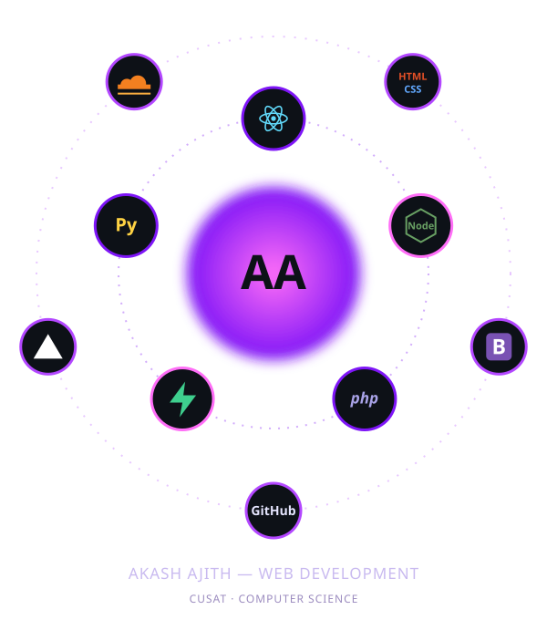
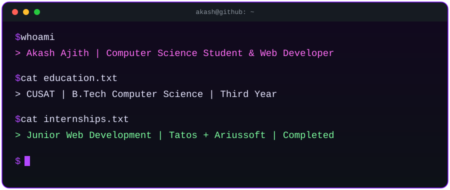

#Hi there👋
<!--
  Akash Ajith | Third-year B.Tech Computer Science student
  Cochin University of Science and Technology (CUSAT)
  Web development internships at Tatos and Ariussoft
  React, Node.js, PHP, HTML, CSS, Bootstrap, Supabase,
  GitHub, Vercel, Cloudflare, C, C++, Python
-->

 

  

 

## 👨‍💻 Developer Profile

> **Computer Science student at CUSAT · Web development experience at Tatos and Ariussoft.**

I'm **Akash Ajith**, a **third-year B.Tech Computer Science student** at **Cochin University of Science and Technology (CUSAT)**.

I've completed **Junior Web Development internships** at **[Tatos](https://tatos.tech/)** and **[Ariussoft](https://ariussoft.com/)**. My web development experience includes **React, Node.js, and Supabase**, along with **PHP, HTML, CSS, and Bootstrap**.

I've also learned **GitHub for version control**, **Vercel for hosting**, and **Cloudflare for image storage**, alongside programming in **C, C++, and Python**.

<table>
<tr><th align="left">Category</th><th align="left">Detail</th></tr>
<tr><td>🎓&nbsp;<b>Education</b></td><td>Third-year <b>B.Tech in Computer Science</b></td></tr>
<tr><td>🏛️&nbsp;<b>University</b></td><td><b>Cochin University of Science and Technology (CUSAT)</b></td></tr>
<tr><td>💼&nbsp;<b>Internships</b></td><td>Junior Web Development at <a href="https://tatos.tech/"><b>Tatos</b></a> and <a href="https://ariussoft.com/"><b>Ariussoft</b></a></td></tr>
<tr><td>💻&nbsp;<b>Web development</b></td><td>React, Node.js, Supabase, PHP, HTML, CSS, and Bootstrap</td></tr>
<tr><td>☁️&nbsp;<b>Development tools</b></td><td>GitHub for version control · Vercel for hosting · Cloudflare for image storage</td></tr>
<tr><td>🧠&nbsp;<b>Programming</b></td><td>C, C++, and Python</td></tr>
</table>

 

## 🌌 Core Skills — Live Orbit

<table>
<tr><th align="left">Capability</th><th align="left">Tools &amp; Experience</th></tr>
<tr><td>🌐&nbsp;<b>Frontend Development</b></td><td>Web interfaces with React, HTML, CSS, and Bootstrap</td></tr>
<tr><td>🔧&nbsp;<b>Backend Development</b></td><td>Web development with Node.js and PHP</td></tr>
<tr><td>🗄️&nbsp;<b>Backend Services</b></td><td>Supabase in web development projects</td></tr>
<tr><td>☁️&nbsp;<b>Hosting &amp; Storage</b></td><td>Vercel for hosting and Cloudflare for image storage</td></tr>
<tr><td>🔀&nbsp;<b>Version Control</b></td><td>GitHub for managing project code</td></tr>
<tr><td>🧠&nbsp;<b>Programming Languages</b></td><td>C, C++, and Python</td></tr>
</table>

 

## 💻 Profile Terminal

 

## 🛠️ Tech Stack Command Center

**🌐 Frontend Development**

`HTML` `CSS` `Bootstrap` `React`

**🔧 Backend Development**

`PHP` `Node.js`

**🗄️ Backend Services**

`Supabase`

**☁️ Version Control, Hosting & Image Storage**

`GitHub — Version Control` `Vercel — Hosting` `Cloudflare — Image Storage`

**🧠 Programming Languages**

`C` `C++` `Python`

 

## ⚡ GitHub Activity

 

  

<!-- Generated by .github/workflows/snake.yml after its first successful run. -->
<picture>
  <source media="(prefers-color-scheme: dark)" srcset="https://raw.githubusercontent.com/Akash555-Ajith/Akash555-Ajith/output/github-contribution-grid-snake-dark.svg"/>
  <source media="(prefers-color-scheme: light)" srcset="https://raw.githubusercontent.com/Akash555-Ajith/Akash555-Ajith/output/github-contribution-grid-snake.svg"/>
  
</picture>

 

## 🤝 Let's Connect

Connect with me to talk about **web development**, **Computer Science**, and **student projects**.

* 🌐 **Frontend** — React, HTML, CSS, and Bootstrap
* 🔧 **Backend** — Node.js, PHP, and Supabase
* ☁️ **Development tools** — GitHub, Vercel, and Cloudflare
* 🧠 **Programming** — C, C++, and Python

**💻 GitHub →** [Akash555-Ajith](https://github.com/Akash555-Ajith) &nbsp;|&nbsp; **🔗 LinkedIn →** [Akash Ajith](https://www.linkedin.com/in/akash-ajith-064573349) &nbsp;|&nbsp; **📧 Email →** [akashajith2005@gmail.com](mailto:akashajith2005@gmail.com)

 

> **Akash Ajith**
>
> ***Third-year B.Tech Computer Science · CUSAT · Web Development***

<!--
**Akash555-Ajith/Akash555-Ajith** is a ✨ _special_ ✨ repository because its `README.md` (this file) appears on your GitHub profile.

Here are some ideas to get you started:

- 🔭 I’m currently working on ...
- 🌱 I’m currently learning ...
- 👯 I’m looking to collaborate on ...
- 🤔 I’m looking for help with ...
- 💬 Ask me about ...
- 📫 How to reach me: ...
- 😄 Pronouns: ...
- ⚡ Fun fact: ...
-->
